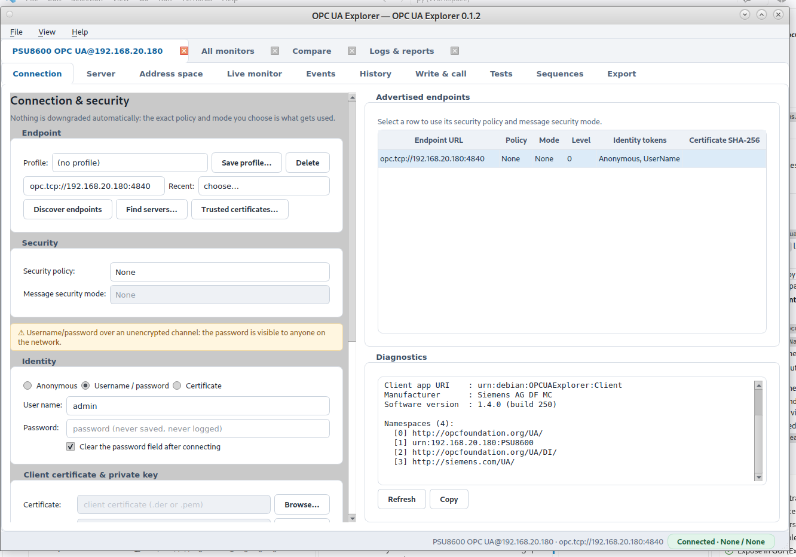

# OPC UA Explorer

Desktop **OPC UA client** for browsing, downloading, exporting, monitoring, writing values, calling methods and
running operator sequences against an OPC UA server — with deliberate, explicit security handling.

Python 3.11+ · [asyncua 2.1.0](https://pypi.org/project/asyncua/) · PySide6 6.11.3 · managed with `uv` · native
Windows and Linux, no Docker.

> **Status — complete and maintained (2026-11-18)**
> Implemented and tested: connection & security with automatic reconnect, multi-session window, a FindServers
> directory lookup, address-space
> browser and bounded download, JSON/CSV/NodeSet2 export with validation, headless NodeSet2 export
> (`opcua-export`), live data-change monitoring with a merged view, live event subscriptions with a per-field
> detail view, server status & diagnostics and raw history reads, functional tests with JSON/HTML reports,
> guarded single-target write/method-call checks with explicit confirmation, an
> interactive **Write & call** page (confirmed write with read-back and optional verified restore, confirmed method
> call with the server's argument types),
> connection profiles and versioned project files, a headless comparison of two address spaces
> (`opcua-compare`, also available as a Compare tab and usable with saved JSON exports), and operator-written
> control sequences with a gate, dry run and run timeline (Sequences tab and `opcua-run-sequence`). The automated
> suite has 626 tests. See
> [Limitations](#10-limitations) for what is deliberately *not* claimed, [PLAN.md](PLAN.md) for the
> delivered scope and [HANDOFF.md](HANDOFF.md) for maintenance guidance.



---

## 1. What you can do with it

Each session lives in its own tab (**File → New connection**, `Ctrl+N`) with its own OPC UA client, so you can
work with several devices — or the same server twice — at the same time. A session tab contains the pages below.
Three tabs are shared: **All monitors** (a merged view of every session's monitored items
and notification log, with a session filter), **Compare** (a structural comparison of two sessions) and
**Logs & reports** (operator summaries prefixed with the session name). Closing a session tab releases only that
session's client.

| Page | Capability |
|---|---|
| **Connection** | Enter an endpoint URL, **Find servers…** in a directory (FindServers on an LDS/GDS or any server, with an optional application-URI filter) and take an advertised URL, discover the server's advertised endpoints, choose policy + message security mode, authenticate anonymously / username-password / certificate, configure client certificate & key, configure timeouts, keep reconnecting when the link drops (on by default), connect/disconnect, read diagnostics |
| **Address space** | Lazy tree from Root/Objects or any NodeId with a **browse filter** (reference type, `Forward`/`Inverse`/`Both`, include subtypes, `NodeClassMask`), attributes panel with every standard attribute of the selected NodeClass (including **EventNotifier**, WriteMask/UserWriteMask, Historizing, MinimumSamplingInterval, IsAbstract/Symmetric/InverseName, DataTypeDefinition) and decoded bit-field names, references panel with direction, explicit value read with **IndexRange**, **MaxAge** and **TimestampsToReturn**, copy NodeId, search inside a downloaded snapshot; rows of nodes in this session's live monitor are marked with **●** while the subscription runs and **○** when added but not subscribed (bold, session-local) |
| **Export** | Download whole address space or a subtree with namespace filter, depth/node budget, request concurrency and batch size, progress and cancellation; explicit content switches for variable values and node descriptions; an **Export coverage** panel that states what the snapshot contains, what it never contains (details-panel-only attributes) and what each format can carry; write JSON, CSV or NodeSet2 XML (with dependency closure, missing-dependency report and optional XSD validation) |
| **Live monitor** | One data-change subscription on NodeIds you add explicitly (also via **Monitor node** in the Address space tab); per-node table with the **latest value updated in place** (value, StatusCode, source timestamp, notification count) plus an append-only notification log; optional **DataChangeFilter** (trigger `Status`/`StatusValue`/`StatusValueTimestamp`, absolute or percent deadband), pause/clear, add/remove monitored items while running, configurable publishing/sampling intervals with **Apply intervals** on the live subscription, server-side **Reporting/Sampling/Disabled** monitoring mode, and bounded row retention |
| **Events** | One event subscription on the source nodes you add explicitly (the Server object by default, any node with an `EventNotifier`, also via **Use browser selection**); fields come from the server's event type (`BaseEventType` or a custom type you name); bounded event log with received time, source, event type, severity and message, a per-field detail view for the selected event, server-side filtering (extra EventType
fields and a minimum severity), add/remove sources while running, and a clear rejection report per source; condition events from a `ConditionType` subscription can be acknowledged with one confirmed `Acknowledge` method call (no `Confirm`/`Enable`, never retried) |
| **Server** | **ServerStatus** and **ServerDiagnostics**: state, current/start time, uptime, shutdown fields, the diagnostics-summary counters, ServerCapabilities limits this client depends on, and this session's live-monitor items (client view); one batched Read per **Refresh**, no write and no method call |
| **History** | Raw **HistoryRead** of one variable (also via **Use browser selection**): optional From/To range, a value cap, and a table of source/server timestamps, StatusCode and value; continuation points are followed up to a fixed cap and released, results are sorted oldest-first, and a node that does not historize is reported as such instead of as an error |
| **Write & call** | Interactive single-target operations, each after a confirmation showing the exact endpoint, node, value or arguments: write one variable value (parsed with the server's DataType/ValueRank, sent once, read back and compared, with an optional *restore the previous value* that is one further verified write), write one **metadata attribute** (`DisplayName` or `Description`, read back and compared), call one method (the arguments come from the server's `InputArguments`, `Executable` is checked, the call is sent once and its output arguments are shown) and **node management**: create one `Object` or `Variable` below a parent (the server assigns the NodeId, the new node is read back) or delete one node (one `DeleteNodes`, verified by reading it again). **Read node** shows NodeClass, DataType, ValueRank, access level and the current value |
| **Tests** | Functional checks (discovery, session/identity, namespaces, browsing, attributes, value reads with StatusCodes, subscription creation and monitored-item notifications, bounded latency, opt-in connection recovery) plus optional **guarded** single-target write and method-call checks behind an explicit confirmation; JSON and HTML reports |
| **Sequences** | Run an operator-written sequence document (`*.opcua-sequence.json`): `preconditions` that run before anything else (typically `assert` / verification checks; an `optional` `ensure` may set a prerequisite and therefore writes), an optional gate (acquire / keepalive / release) and a body of `write`, `expect`, `assert`, `ensure`, `call`, `delay`, `wait_until`; inputs via `${name}`; **Dry run** resolves every target, DataType and method signature and sends nothing; **Run** sends each step once, reads values back where the document asks, and reports the gate release |
| **Logs & reports** | Live log with secret redaction, save/copy, operational summaries and written report paths |
| **Compare** | Structural comparison of two sessions, or of a session and a saved JSON export: pick reference and candidate, download the live side(s) with one scope, then review differences (missing / extra / changed / not comparable) with a filter and a per-node attribute detail; export the JSON or HTML report |

**File → Save project… / Open project…** stores and restores every session's configuration and editor state in
one versioned JSON file — never credentials.

Everything the **Export** page writes can also be produced without the GUI: `uv run opcua-export …` exports a
NodeSet2 XML file headlessly (see [Headless export](#headless-export-the-opcua-export-command)).
Two devices can be compared headlessly with `uv run opcua-compare …` (see
[Headless comparison](#headless-comparison-the-opcua-compare-command)).

## 2. Requirements

* Python **3.11 – 3.13**
* Windows 10/11 or a Linux desktop (X11 or Wayland) with the usual Qt runtime libraries
* No Docker, no server installation required — a demo server is included

## 3. Install

The project is managed with [`uv`](https://docs.astral.sh/uv/). Install it once:

```bash
# Linux / macOS
curl -LsSf https://astral.sh/uv/install.sh | sh

# Windows (PowerShell)
powershell -ExecutionPolicy ByPass -c "irm https://astral.sh/uv/install.ps1 | iex"
```

Then, from the project root:

```bash
uv sync                 # creates .venv and installs pinned dependencies
uv run opcua-explorer   # start the desktop application
```

Windows `cmd.exe` / PowerShell use the same commands. If you prefer plain `pip`:

```bash
python -m venv .venv
# Linux
source .venv/bin/activate
# Windows PowerShell
.venv\Scripts\Activate.ps1
pip install -e .
opcua-explorer
```

Pinned runtime dependencies (`pyproject.toml`): `asyncua==2.1.0`, `PySide6==6.11.3`; `uv.lock` pins the full
resolved set. The asyncua API used by this project was verified against the installed package — see
[docs/api-verification.md](docs/api-verification.md).

### Prebuilt bundles (no Python required)

GitHub Actions builds a Windows and a Linux bundle on every push to `main`; a `v*` tag attaches them to
the GitHub Release. Unpack an archive and run the executable inside — **Python and `uv` are not needed
on the target machine**:

| Archive | Contents |
|---|---|
| `opcua-explorer-windows-x64.zip`, `opcua-explorer-linux-x64.zip` | desktop application (`opcua-explorer[.exe]`) |
| `opcua-export-windows-x64.zip`, `opcua-export-linux-x64.zip` | headless NodeSet2 exporter (`opcua-export[.exe]`), no Qt |
| `opcua-compare-windows-x64.zip`, `opcua-compare-linux-x64.zip` | headless address-space comparison (`opcua-compare[.exe]`), no Qt |

`opcua-run-sequence` is currently run from a `uv` checkout; it is not part of a bundle yet.

A bundled install and a `uv`-run checkout on the same machine share their settings, trust store and
project files, because both use the same per-user locations. The Windows binaries are unsigned, so
SmartScreen warns on first launch. Build them yourself with the specs in [`packaging/`](packaging/README.md).

## 4. Five-minute walkthrough

Terminal 1 — start the demo server:

```bash
uv run opcua-demo-server            # opc.tcp://127.0.0.1:4840
```

Terminal 2 — start the GUI:

```bash
uv run opcua-explorer
```

1. **Connection** tab: endpoint `opc.tcp://127.0.0.1:4840` → **Discover endpoints**. The table lists what the
   server actually advertises (security policy, mode, identity tokens, certificate fingerprint).
   **Find servers…** asks a discovery endpoint which applications it knows (the demo server lists itself); select
   an entry and **Use selected URL** to put its advertised endpoint into the URL field. It is a plain FindServers
   call on a temporary unencrypted channel — no session and no certificate decision.
2. Press **Connect**. For an unencrypted local demo no certificate review is needed; for secure endpoints a
   certificate dialog appears first.
   *Need a second device?* **File → New connection** opens another session tab with its own client and pages; the
   status bar then shows how many sessions are open and how many are not connected.
3. **Address space** tab opens on the Objects folder. Expand `Plant → Line1`. Select a node to see its
   attributes (NodeId, namespace URI, DataType with resolved name, ValueRank, AccessLevel, …), its references
   with direction, and — on the *Value* sub-tab — an explicit **Read value** with optional **IndexRange** (e.g.
   `1:3`), **MaxAge** (`0` lets the server answer from a cache) and **TimestampsToReturn**
   (`Source`/`Server`/`Both`/`Neither`). The **References** row above the tree filters a browse by reference type
   (`Organizes`, `HasComponent`, all references), direction and `NodeClassMask`; **Apply filter** reloads the current
   root with it. Rows of nodes in the live monitor
   are shown bold and prefixed with **●** while the subscription runs, or **○** when they are added but not yet
   subscribed (per session); the marker disappears when the node is removed from the monitor list.
4. **Live monitor** tab: add `ns=2;s=Temperature` (or press **Monitor node** in the Address space tab), set a
   publishing/sampling interval and press **Start monitoring**. Optionally choose a **Trigger** and an absolute or
   percent **Deadband** before starting; the filter is sent as a `DataChangeFilter` and the server applies it. The
   left table keeps **one row per node and overwrites it with the latest value, StatusCode, source timestamp and
   notification count**; the right table is an append-only notification log. Select a monitored item or a log row
   to see the full payload. **Add node** subscribes further nodes into the same subscription while it runs,
   **Pause** freezes the log but keeps the latest values updating, **Apply intervals** modifies the running
   subscription (`ModifySubscription`/`ModifyMonitoredItems`, the server may revise), and **Server mode** applies
   `SetMonitoringMode` (Reporting / Sampling / Disabled) to every monitored item. **Stop** deletes the
   subscription. With several sessions open, the shared **All
   monitors** tab shows every session's items in one table (session column, filter, merged log);
   start/stop stays in each session's own tab.
   The **Events** tab is the corresponding page for event notifications: start the demo server with
   `uv run opcua-demo-server --event-interval 1`, add the Server object (`i=2253`) and press **Start events**;
   select a row to see every field the server published. With an event type such as `ConditionType` (`i=2782`) the
   selected condition event can be acknowledged: **Acknowledge condition…** asks for an optional comment, shows the
   exact target and EventId, and sends one `Acknowledge` method call after confirmation.
   The **Server** tab reads `ServerStatus`, the `ServerDiagnostics` summary and the ServerCapabilities limits with
   one batched Read when the session connects or **Refresh** is pressed; it also lists this session's live-monitor
   items. Optional values the server returns as null are shown as *not provided*, never as zero.
   The **History** tab reads a variable's stored values: start the demo server with `uv run opcua-demo-server
   --history`, put `ns=2;s=Temperature` in *NodeId* (or use **Use browser selection**) and press **Read history**.
   Leave *From*/*To* unchecked for the whole stored range, or tick them to bound it; *Max values* caps the result.
   The server decides which values it keeps and in which order it returns them; the table is sorted oldest-first.
   A variable the server does not historize returns no rows and the StatusCode/`Historizing` hint in the status
   line — that is a fact about the server, not a client error.
5. **Export** tab: keep *whole address space*, set *Maximum nodes* to e.g. 500, press **Download**. Progress,
   counters and cancellation are available. The *Export content* group decides whether variable values and node
   descriptions become part of the snapshot (values are off by default), and *Export coverage* lists exactly
   what was collected, which options were off and what a snapshot can never contain. Then **Export JSON…**,
   **Export CSV…** or **Export NodeSet2…**.
6. **Tests** tab: optionally put a variable NodeId (e.g. `ns=2;s=Temperature`) in *Variable node*, press
   **Run tests**. Eleven checks run against the existing session; select a row to see StatusCodes and
   measurements, then **Export JSON report…** or **Export HTML report…**. Leave the variable empty and one is
   discovered near the browse root.
7. **Optional guarded write** (demo only): in *Guarded write & method call* enter `ns=2;s=Temperature`, a value
   such as `42.5`, press **Add write target**, tick the consent box and **Run tests**. A dialog repeats the exact
   target, value and restore choice; confirm it and the write is read back (and restored only if you ticked the
   restore box). The demo's `Start` method can be called the same way: object `ns=2;s=Motor`, method
   `ns=2;s=Start`, argument `900`.
   The same operations are available interactively in the **Write & call** page: **Read node** shows the type and
   current value, **Write value…** confirms the exact target and reads the value back, and **Read signature** +
   **Call method…** does the same for one method (object `ns=2;s=Motor`, method `ns=2;s=Start`, argument `900`).
   The same page can also change a node's `DisplayName` or `Description` (**Write attribute…**, with the same
   confirmation and read-back); most servers return `BadUserAccessDenied` for that unless you are an administrator.
   The **Node management** group creates one `Object` or `Variable` below a parent (BrowseName, DisplayName,
   DataType and initial value for a variable; the server assigns the NodeId) or deletes the target node — one
   request each, after a confirmation, and also admin-only on most servers.
8. **Compare** (two sessions): open a second session with **File → New connection** and connect it to the other
   device, then switch to the shared **Compare** tab, choose *Reference* and *Candidate* and press **Compare**.
   Both address spaces are downloaded again with one scope; the table lists every difference (missing / extra /
   changed / not comparable) and the selected row shows its attribute detail. Use *Show* or the filter field to
   narrow the list, then **Export HTML report…** or **Export JSON…**. If the old device is already gone, pick
   *Saved JSON export…* for that side and select a document previously written with **Export JSON…**.

### Saving and reopening your work

**File → Save project…** (`Ctrl+S`) writes one versioned JSON file describing every open session;
**File → Open project…** (`Ctrl+O`) replaces the current session tabs with the file's sessions (you are asked
first when a session is connected).

A project stores, per session: endpoint URL, security policy and mode, identity mode, user name (never the
password), client certificate/key **paths** (never the key password), timeouts, the auto-reconnect choice, the
address-space start NodeId, the export settings (scope, limits, namespace filter, value/description/dependency
options), the
live-monitor target NodeIds and intervals, and the Tests settings including configured write/method targets.

It deliberately does **not** store passwords, private-key passwords, server certificates, trust decisions,
downloaded address spaces, monitor logs or test reports. Opening a project never connects, subscribes,
downloads, writes or runs anything, and the guarded-write master switch always comes back unticked. The trust
store stays in the machine configuration, so a project file cannot make a certificate trusted.

The demo model intentionally contains a **shared child** (`SharedConfig` is referenced from `Objects`, `Plant`
and `Line1`), a **cycle** (`Motor` references `Plant`), a **second namespace**, a **custom DataType**, and
values of type Double, Boolean, String, array, DateTime, ByteString and ExtensionObject.

Demo identities (documented demo values, never logged): user `demo`, password `demo-pass`.
Start with `--no-username` to disable username authentication.

## 5. Security behaviour (by design)

* **No silent downgrade.** The policy/mode pair you select must be advertised by the server. If it is not, the
  connection fails with the list of advertised combinations. Discovery always uses `SecurityPolicy#None`
  because `GetEndpoints` is a channel-level service; the session itself then uses exactly the chosen endpoint.
* **Explicit certificate approval.** For a secure endpoint the server certificate is parsed locally and its
  SHA-256 fingerprint is shown. Nothing connects until you tick "I verified this fingerprint out-of-band".
  Approved fingerprints are stored in the trust store; a **changed** certificate triggers a new review.
  The approved DER bytes are handed to `set_security(..., server_certificate=...)`, which is the only path that
  skips asyncua's own implicit certificate fetch.
* **Credentials are not persisted.** Saved connection profiles have no password field at all (there is no
  attribute to write), and `assert_no_secrets()` re-checks the JSON before it is written. Passwords and
  private-key passwords live only in memory and are cleared from the form after connecting.
* **No secrets in logs.** A logging filter redacts registered secret values, `password=…`-style patterns, PEM
  private-key blocks — including formatted exception tracebacks.
* **Writes only for configured targets.** Browsing, download, export, live monitoring and history send only
  `Read`, `Browse`, `CreateSubscription`/`CreateMonitoredItems`, `HistoryRead`,
  `DeleteMonitoredItems`, `DeleteSubscriptions` and `FindServers`, and the default test run does not write. A
  write or method call is sent for the single target the operator configured and confirmed — in the **Tests**
  tab, the **Write & call** page or an operator-written sequence document — and every one of them goes through
  the same `opcua/write_service.py` path with `WriteAuthority`. Nothing is discovered, repeated or automated.
  The one disruptive check (connection recovery) is opt-in and runs last.

Trust store location: `%APPDATA%\opcua-explorer\trusted_server_certificates.json` on Windows,
`~/.config/opcua-explorer/trusted_server_certificates.json` on Linux. It is managed in the GUI via
**Trusted certificates…**.

### Optional: try a secure connection

```bash
# Generate a throw-away server certificate (valid 365 days, SAN = hostname)
uv run python - <<'PY'
import asyncio, socket
from pathlib import Path
from asyncua import Client
from cryptography.x509 import ExtendedKeyUsageOID

async def main():
    client = Client("opc.tcp://127.0.0.1:4840")
    client.application_uri = "urn:opcua-explorer:demo:server"
    await client.setup_self_signed_certificate(
        Path("server.pem"), Path("server.der"),
        host_name=socket.gethostname(),
        extended=[ExtendedKeyUsageOID.CLIENT_AUTH, ExtendedKeyUsageOID.SERVER_AUTH],
    )
asyncio.run(main())
PY

uv run opcua-demo-server --cert server.der --key server.pem
```

The server then advertises only `Basic256Sha256 / SignAndEncrypt`. To connect you also need a **client**
certificate whose subjectAltName contains the application URI shown in the Connection tab
(`urn:<hostname>:OPCUAExplorer:Client`) — see [docs/troubleshooting.md](docs/troubleshooting.md).
Generate it the same way with that URI and pass the `.der`/`.pem` files in the *Client certificate & private key*
group.

## 6. Project layout

```
src/opcua_explorer/
├── config.py             settings, connection profiles (no secrets), trust store, profile→settings
├── models/               plain dataclasses per feature cluster, re-exported from __init__.py
├── defaults.py           numeric defaults shared by model, project files and tabs
├── project.py            versioned project files (configuration and editor state only)
├── formatting.py         Qt/asyncua-free cell formatting shared by the exporters
├── operator_text.py      guarded-operation confirmation + connection diagnostics text (Qt-free)
├── logging_setup.py      log bus + mandatory secret redaction
├── reporting.py          JSON and self-contained HTML test reports
├── compare.py            structural comparison of two address-space snapshots (Qt/asyncua-free)
├── sequence_document.py  read/validate *.opcua-sequence.json (Qt/asyncua-free)
├── cli.py                opcua-export: headless NodeSet2 export (Qt-free, same services as the GUI)
├── cli_compare.py        opcua-compare: headless comparison of two servers (Qt-free)
├── cli_sequence.py       opcua-run-sequence: headless run of a sequence document (Qt-free)
├── opcua/
│   ├── ua_names.py       shared NodeClass / StatusCode / VariantType names
│   ├── check_support.py  shared check primitives (skipped signal, previews, environment)
│   ├── security.py       policy/URI mapping, certificate parsing, anti-downgrade endpoint selection
│   ├── browse.py         continuation-point aware Browse/BrowseNext (releases points on cancel)
│   ├── attributes.py     batched attribute reads and decoding
│   ├── traversal.py      graph traversal: visited set, depth/node budget, concurrency, limits report
│   ├── serialize.py      JSON-safe value encoding (ByteString, DateTime, arrays, ExtensionObject)
│   ├── nodeset2.py       NodeSet2 XML: dependency closure, unsupported DataType report
│   ├── nodeset2_validation.py  well-formedness, structural checks, optional XSD validation
│   ├── test_runner.py    functional checks and run orchestration
│   ├── guarded_operations.py  opt-in single-target write / method-call checks
│   ├── write_service.py  the one write/method-call/restore implementation (prepare → send → read back)
│   ├── value_parsing.py  operator text → typed value (built-in scalars and arrays)
│   ├── type_support.py   server-driven typing: built-ins, enumerations, structures
│   ├── method_support.py shared DataType/ValueRank, InputArguments and Executable reads
│   ├── path_support.py   TranslateBrowsePathsToNodeIds (complete, unambiguous matches only)
│   ├── sequence_runner.py  universal sequence engine (gates, keepalive, dry run)
│   ├── monitor_service.py  live data-change subscription: monitored items, JSON-safe notifications
│   ├── monitor_session.py  one session's live-subscription lifecycle
│   ├── event_session.py    one session's event-subscription lifecycle
│   ├── node_reader.py      session-bound browse, node-detail and value reads
│   ├── node_ids.py         NodeId normalisation shared by service and collaborators
│   ├── session_setup.py    discovery, client construction, security/identity, namespaces
│   ├── history_service.py  raw HistoryRead: request shape, continuation points, decoding
│   └── client_service.py the only owner of an asyncua Client
├── exporters/            json_exporter.py, csv_exporter.py, json_loader.py
├── gui/
│   ├── app.py            entry point and orderly Qt/asyncio shutdown
│   ├── main_window.py    window shell: session tabs, menus, status bar, shared tabs
│   ├── session_workspace.py  one session: its service and ten pages
│   ├── async_runner.py   the only bridge between Qt and asyncio
│   └── tabs/             connection (+ connection_dialogs, server_directory_dialog), browser, export, monitor, events, server, history, write, tests, sequences, logs, unified monitor, compare
└── demo/demo_server.py   local demo server with a graph-shaped model
tests/unit, tests/integration
examples/                 generated sample exports and sample reports
docs/                     architecture, API verification, troubleshooting
PLAN.md, AGENTS.md, HANDOFF.md  delivered scope, working rules, maintenance guidance
```

Key design decision: **all asyncua work runs on one asyncio loop in a worker thread**; the GUI thread only
receives plain model objects through queued Qt signals. No `await` ever runs on the GUI thread. The CLI is a
second, Qt-free front end: it owns its own event loop and calls the very same `OpcUaService` and exporters.

## 7. Export formats

**JSON** (`format_version` 1) — canonical document:

* `nodes` is an object keyed by session NodeId string, one entry per node with node class, browse/display name,
  description, data type (NodeId **and** resolved name), value rank, array dimensions, access levels,
  type definition, optional value snapshot, and the StatusCode of every attribute the server refused;
* `references` is a separate de-duplicated list of **forward** edges (`source`, `target`, `reference_type`,
  `reference_type_name`, `target_included`);
* `namespaces` always carries the **URI table**, because namespace indexes are session-local;
* `source` documents endpoint, security configuration, roots, the complete traversal configuration (depth/node
  limits, references per node, namespace filter, value/description/subtype switches) and `limitations`;
* `summary` holds counts, duration, limits hit, inaccessible nodes and unsupported encodings.

**CSV** — one row per node with the important attributes, reference in/out counts, and (only when enabled)
value, status, encoding and timestamps. `unavailable_attributes` lists every attribute the server refused as
sorted `Attribute=StatusCode` pairs, and `value_status`/`value_encoding` stay populated for a refused or
undecodable Value, so such a value cannot be mistaken for one that was not requested. UTF-8 with BOM so Excel
on Windows detects the encoding.

Values are **excluded by default**. When enabled, supported values are encoded consistently:
arrays keep order, `DateTime` → `{"$type":"DateTime","iso":…}`, `ByteString` → base64,
`ExtensionObject` → `{"$type":"ExtensionObject","type_id":…,"body":…}`. Anything that cannot be represented
faithfully is flagged (`encoding: "unsupported"` plus a `kind`/`detail` entry) instead of being silently
stringified.

Example files: [examples/demo-address-space.json](examples/demo-address-space.json),
[examples/demo-address-space.csv](examples/demo-address-space.csv) (generated from the demo server with
`--max-nodes 300`, values off). Regenerate them with:

```bash
uv run python scripts/generate_example_exports.py
uv run python scripts/generate_example_report.py
uv run python scripts/generate_example_nodeset.py
```

### NodeSet2 XML

The **Export NodeSet2…** action writes a `UANodeSet` document for the downloaded snapshot:

* **Dependencies are collected first, not assumed.** Before writing anything the exporter walks the snapshot and
  pulls in what a consumer needs: parents (so `ParentNodeId` resolves), supertypes, `HasTypeDefinition` targets,
  `HasEncoding` nodes, type members of exported types and `InputArguments`/`OutputArguments` of exported methods.
  Namespace-0 nodes are **referenced, never duplicated**.
* **Method arguments are part of the file.** The argument property values are written even when value export is
  off, because a method without them is declared but not callable.
* **Missing dependencies are reported, not invented.** Every dependency that cannot be read (access denied,
  budget reached, collection disabled) is listed with the reason and the relationship that needed it.
* **Custom DataTypes without a `DataTypeDefinition`** cannot be described in NodeSet2. They are excluded together
  with their members, reported as unsupported (with the affected variables), and the file stays importable.
* **The file validates itself.** After writing, the exporter re-parses its own output, checks namespace
  declarations, `ParentNodeId` resolvability and dangling references, and optionally validates against the
  official NodeSet2 XSD (`uv sync --extra validation` installs `lxml`). Without `lxml` the result says
  *schema validation skipped* — it never claims a validation that did not happen.
* **No completeness claims.** The result document lists what the file contains, what is missing and why, and
  states that an export from a live session reflects only what that session was allowed to browse.

Example: [examples/demo-nodeset2.xml](examples/demo-nodeset2.xml) with the machine-readable result in
[examples/demo-nodeset2-manifest.json](examples/demo-nodeset2-manifest.json). The committed example exports the demo's
`Objects` folder, so the custom `MeasurementType` (a type node created under `Types`) is outside that snapshot. When
a snapshot includes a custom DataType without a `DataTypeDefinition`, it is listed in `unsupported_data_types`
instead of being written (covered by the integration tests).

### Headless export: the `opcua-export` command

The GUI is not required to write a NodeSet2 file. `opcua-export` is a Qt-free command that drives exactly the same
code as the **Export** tab — same session handling, same bounded traversal, same dependency closure, same writer
and same self-validation — so a scripted export and a GUI export cannot differ:

```bash
uv run opcua-export --endpoint opc.tcp://192.168.1.100:4840 --output PSU8600.NodeSet2.xml
```

The command word is optional (`opcua-export export …` works too) and `--endpoint` / `--help` list every option.
Frequently used ones:

| Option | Meaning |
|---|---|
| `--output FILE` | Destination; default `<host>-<port>.NodeSet2.xml` in the working directory |
| `--node NODEID` (repeatable) | Start node(s); default `i=85` (Objects). Parents are added as dependencies |
| `--namespace INDEX` (repeatable) | Keep only these namespaces; namespace 0 is always kept because the type system lives there |
| `--max-nodes N`, `--max-depth N` | Bounds, `0` = unlimited (default: 20 000 nodes) |
| `--values` | Also read variable values (off by default) |
| `--no-dependencies` | Skip parent/type collection — the file will usually not import |
| `--max-dependencies N`, `--schema XSD` | Dependency budget and optional XSD validation |
| `--manifest FILE` | JSON result document (counts, namespaces, missing dependencies, unsupported DataTypes, validation) |
| `--policy`, `--mode`, `--client-certificate`, `--client-key` | Same security selection as the GUI; no silent downgrade |
| `--user`, `--password-env VAR` | User-name identity; the password comes from an environment variable or an interactive prompt, never from argv |
| `--server-certificate FILE`, `--trust-server-certificate`, `--trust-store FILE` | Explicit server-certificate approval; the application trust store is used by default |
| `--quiet`, `--verbose` | Progress/result only, or debug logging on stderr |

Progress and the export summary go to **stdout/stderr**, so the command is scriptable:

```bash
# Export one device subtree from a secured endpoint; output stays parseable by CI
OPCUA_EXPLORER_PASSWORD=… uv run opcua-export \
  --endpoint opc.tcp://plc.example:4840 \
  --node "ns=2;s=MyDevice" --namespace 2 \
  --policy Basic256Sha256 --mode SignAndEncrypt \
  --client-certificate client.der --client-key client.pem \
  --trust-store /etc/opcua-explorer/trust.json \
  --quiet --output MyDevice.NodeSet2.xml --manifest MyDevice.json
```

Exit codes: `0` success, `1` connection or export failure, `2` unusable arguments/configuration,
`3` the file was written but failed its own structural checks (it may not import).

#### Scope, namespaces and permissions

* **Scope.** Default scope is the `Objects` folder. `--node` selects any subtree, `--namespace` restricts the
  download to your own namespaces. Namespace 0 is never written into the file: the standard type system is
  *referenced*, so the importing tool must know the standard NodeSet.
* **Namespace mapping.** The exporter re-maps the *session's* namespace indexes onto the file's own
  `NamespaceUris` table (index 1, 2, … in the order the file declares them). NodeId **identifiers** are preserved;
  the numeric prefix inside the file therefore need not match the index the server used in that session. Always
  resolve a NodeId through the file's `NamespaceUris` table, not through a remembered session index.
* **Permissions.** Only what the session could read ends up in the file. Access-denied or timed-out nodes,
  exhausted budgets and unreadable dependencies are listed in the summary and in `--manifest`, never invented.
  Servers that expose only partial metadata still produce a file; the affected nodes appear as missing
  dependencies or unsupported DataTypes.
* **Cycles and size.** The traversal tracks visited NodeIds, so a graph with cycles terminates; continuation
  points are released, including on cancellation. Memory use is bounded by `--max-nodes` / `--max-dependencies`.

#### Importing the file into SiOME or UaModeler

The generated file is a plain `UANodeSet` document (schema namespace
`http://opcfoundation.org/UA/2011/03/UANodeSet.xsd`), so both tools import it directly:

* **Siemens SiOME** — *File → Import → OPC UA Nodeset XML* (or *Nodeset → Import*), select the file. SiOME shows
  the nodes under *Model / Nodeset*, and reports any reference that could not be resolved. Because namespace 0 is
  referenced but not included, a missing custom dependency appears as a "reference to unknown node" message.
* **Unified Automation UaModeler** — *File → Import → NodeSet2 XML* (or *Model → Import*). UaModeler validates
  namespaces and parent relationships on import and refuses files whose nodes have no resolvable parent, which is
  why `ParentNodeId` dependencies are always collected. Use *Model → Validate* afterwards to see dangling
  references that point outside the file.

Practical guidance:

1. Export with dependencies enabled (default) and read the printed summary: `Missing deps`, `DataTypes` and
   `References` lines tell you what an importer will complain about.
2. A custom type defined *outside* the downloaded scope shows up as an unsupported DataType; export an additional
   root (`--node i=86` for the Types folder) or the type's own NodeId to include it.
3. `--values` is only needed when the consuming tool must see initial values; method `InputArguments` /
   `OutputArguments` are always written.

### Headless comparison: the `opcua-compare` command

When a device is replaced, the question is whether the new one exposes the same information model. `opcua-compare`
downloads both address spaces through the same service layer the GUI uses and compares the snapshots. It sends no
write and no method call: nothing is written, called or subscribed.

```bash
uv run opcua-compare --reference opc.tcp://old-device:4840 --candidate opc.tcp://new-device:4840 \
  --json diff.json --report diff.html

# The old device is already gone: compare its saved JSON export with the new one live
uv run opcua-compare --reference-file old-device.json --candidate opc.tcp://new-device:4840
```

The first server is the baseline. Differences are reported in four buckets — *missing on the candidate*,
*extra on the candidate*, *changed attributes* and *not comparable* — plus namespace and (optional) reference
differences. Exit code **3 means “compared, differences found”**, which makes the command usable as a CI gate.
The same comparison is available in the GUI as the shared **Compare** tab, which writes the same reports.

**Each side is either a live endpoint or a saved JSON export.** `--reference-file` / `--candidate-file` read a
document written by the Export tab (*Export JSON…*) or by `opcua-export`'s JSON writer; a side that comes from a
document is not downloaded and needs no connection, and two documents compare completely offline. A truncated
export is reported as such: the document keeps the `limits_hit` flags of its download, so the comparison warns
that one side was cut short instead of reporting the missing nodes as differences.

| Option | Meaning |
|---|---|
| `--reference ENDPOINT`, `--candidate ENDPOINT` | Baseline and replacement |
| `--reference-file FILE`, `--candidate-file FILE` | Use a saved JSON export for that side instead of a live endpoint |
| `--node NODEID` (repeatable) | Roots to download on **both** sides; default `i=85` (Objects) |
| `--tolerance functional\|strict` | `functional` (default): node class, data type, value rank, array dimensions, access levels, type definition. `strict`: also display name and description |
| `--compare-value NODEID` (repeatable) | Compare status, variant type and payload of exactly these nodes (values are read only for them) |
| `--ignore NODEID` (repeatable) | Nodes expected to differ (current time, counters, serial numbers) |
| `--float-tolerance X` | Absolute tolerance for compared numbers (default `0` = exact) |
| `--compare-reference-names` | Also compare the reference graph (type names, sources, targets) |
| `--no-browse-path-match` | Match only by NodeId; disable the browse-path fallback for renumbered nodes |
| `--max-nodes N`, `--max-depth N` | Download bounds per side; `0` = unlimited (default unlimited — a truncated side cannot be compared) |
| `--json FILE`, `--report FILE` | Versioned JSON document and/or self-contained HTML report |
| `--policy`, `--mode`, `--client-certificate`, `--client-key`, `--user`, `--password-env` | Same security and identity selection as `opcua-export`, applied to **both** sessions |
| `--candidate-policy`, `--candidate-mode` | Override the security settings for the candidate only |
| `--reference-server-certificate`, `--candidate-server-certificate` | Per-side approved certificate; `--trust-server-certificate` approves both |
| `--quiet`, `--verbose` | Progress/result only, or debug logging on stderr |

Rules that make the result trustworthy:

* **One identity for both sessions.** `UserAccessLevel` can only be compared when both servers are asked with the
  same user; the command therefore reads the password once and uses it for both. The report states the identity.
* **Namespace URIs, not indexes.** Nodes are identified by namespace URI + identifier, so differently numbered
  namespace tables compare correctly. A NodeId printed in the report is the one *that session* used.
* **Browse-path fallback.** When a NodeId changed but its position did not, the nodes are matched by qualified
  browse path — only when that path is unambiguous on both sides.
* **Partial snapshots are flagged, not hidden.** Cancelled downloads, hit limits, inaccessible nodes and a
  different authentication mode produce warnings; nodes that could be browsed on one side only are *not
  comparable*, never “equal”.
* **Values are a point-in-time read** and are compared only for the nodes you name — a serial number or a counter
  is not a difference in functionality.

Sample files: [examples/sample-comparison.json](examples/sample-comparison.json) /
[examples/sample-comparison.html](examples/sample-comparison.html) (two demo servers, no difference) and
[examples/sample-comparison-differences.json](examples/sample-comparison-differences.json) /
[examples/sample-comparison-differences.html](examples/sample-comparison-differences.html) (the difference tables,
produced from a documented synthetic variant). Regenerate them with:

```bash
uv run python scripts/generate_example_comparison.py
```

The comparison is evidence for the scope that was browsed with that identity. It is not a statement that both
servers behave identically under load, and it sends no write or method call.

### Operator sequences: the Sequences tab

A device that expects an *ordered* workflow (acquire a lock, change a setpoint, read it back, release the lock)
is expressed as a **sequence document** instead of application code. The tab loads such a file, lets you edit its
`${name}` inputs, and runs it:

```bash
uv run opcua-explorer            # Sequences tab: Open sequence…, Dry run, Run, Stop
```

The document has three parts: `preconditions` (run before the gate; `assert` performs no write, an `ensure` may
write a prerequisite), an optional `gate`, and the `steps`. Nothing in the
application names a device or a lock protocol — `gate.on`, `gate.keepalive` and `gate.off` are whatever steps
the document lists. The guarantees are mechanical:

* `gate.off` runs in `finally` — after success, after a failing step, after **Stop** and after a failed
  keepalive. A refused release is shown, never hidden.
* `gate.verify` must pass before the body starts, and a keepalive failure aborts the body (`on_failure: abort`).
* Every step is sent **once**. A cancellation while a write is in flight is reported as `outcome_unknown`.
* **Dry run** resolves NodeIds (including browse paths through `TranslateBrowsePathsToNodeIds`), DataTypes,
  ValueRanks, `InputArguments` and `Executable`, and sends nothing.
* There is **no armed state and no per-write dialog**: a write happens because a step asks for it, is read back,
  and appears in the run timeline. One sequence runs at a time per session.

`input` values may be given in the document; the tab and the command override them per run. The example
[examples/demo-setpoint.opcua-sequence.json](examples/demo-setpoint.opcua-sequence.json) works against the
demo server, [examples/demo-method-call.opcua-sequence.json](examples/demo-method-call.opcua-sequence.json) shows
method calls by browse name and by method NodeId, and
[examples/device-gate.opcua-sequence.json](examples/device-gate.opcua-sequence.json) is a template
that shows a gate with acquire / verify / keepalive / release plus an optional remote-mode step — adapt the
NodeIds and browse names to your device.

**[examples/README.md](examples/README.md) indexes a set of runnable demos** — write/read-back, the four ways to
call a method, `wait_until` with optional preconditions, a gate built from plain writes, failure handling and the
supported value types — each with its purpose and expected exit code. Start the demo server with
`uv run opcua-demo-server --no-updates` for those runs: static values keep `expect`, `assert` and `wait_until`
deterministic.

### Headless run: the `opcua-run-sequence` command

```bash
uv run opcua-run-sequence examples/demo-setpoint.opcua-sequence.json \
    --endpoint opc.tcp://127.0.0.1:4840 --input temperature=42.5 --dry-run
uv run opcua-run-sequence my-device.opcua-sequence.json --endpoint opc.tcp://192.168.1.100:4840 \
    --user operator --password-env PSU_PASSWORD --json run.json
```

It prints each step with its status, StatusCode and read-back result, then the gate outcome. Exit codes: `0`
passed, `1` a step or the gate release failed, `2` usage or an invalid document (nothing is sent). Certificate
approval, identity and timeouts are the same options as `opcua-export`. `--json` writes the whole run (steps,
previous/new values, `outcome_unknown`, gate state).

## 8. Functional tests and reports

The **Tests** tab runs eleven bounded checks against the current session, plus the optional guarded write and
method-call checks described [below](#guarded-write-and-method-call-optional-off-by-default) — the same
operations the **Write & call** page and Sequences use:

| Check | What it establishes |
|---|---|
| Endpoint discovery | The endpoint list is readable and the active policy/mode is still advertised |
| Session state & authentication | The session is active and which identity the server accepted |
| Namespace array | Namespace 0 is present; count and URIs are recorded |
| Browse root / target node | Hierarchical browse returns Good StatusCodes |
| Attribute reads | NodeClass/BrowseName/DisplayName are readable; every status is recorded |
| Variable read | The Value attribute returns Good, with variant type and timestamps |
| Subscription creation | `CreateSubscription` succeeds; requested and effective publishing intervals are recorded |
| Monitored-item notifications | A data change is delivered (initial value always counts as a notification) |
| Bounded read latency | 1–200 sequential reads; min/median/max are measured, not asserted |
| Connection loss & recovery | Opt-in and disruptive: closes the secure channel, reconnects, verifies a read |

Semantics that matter:

* **Creation ≠ notification.** A subscription that is created but delivers nothing within the observation
  window is *skipped* with a reason — not a failure. If the initial value arrives but the value never changes,
  the check passes with an explicit "no value change within the observation window" note.
* **Skipped is not hidden.** Opt-in checks and checks without a target explain exactly why they did not run.
* **Writes only for enabled targets.** The default checks send only Read, Browse, CreateSubscription/CreateMonitoredItems and DeleteSubscriptions. Writes and method calls are sent only for explicitly confirmed, single guarded targets (below), the **Write & call** page or a sequence step that asks for them.
* **Not a certification.** Every report states: *functional and interoperability checks — not official OPC UA
  certification*.

Reports (JSON and self-contained HTML) contain the endpoint, security configuration and authentication mode,
UTC timestamps and durations, the test configuration, passed/failed/skipped results, OPC UA StatusCodes per
operation, measurements, coverage limitations, inaccessible nodes and the environment (app, asyncua, PySide6,
Python, platform). Sample files:
[examples/sample-test-report.json](examples/sample-test-report.json) and
[examples/sample-test-report.html](examples/sample-test-report.html); a report that also contains a guarded write
and a method call is available as
[examples/sample-test-report-guarded.json](examples/sample-test-report-guarded.json) /
[examples/sample-test-report-guarded.html](examples/sample-test-report-guarded.html).

### Guarded write and method call (optional, off by default)

The same **Tests** tab can perform one write and/or one method call — but only as a deliberate, confirmed
action:

* **Off by default.** Nothing is written and no method is called unless you tick *"I understand and allow these
  operations"* **and** add the target. A configured target with the switch off is reported as *skipped*, never
  sent.
* **One target per operation.** You enter the variable NodeId and the value, or the object + method NodeId and
  the arguments. The tool never lists writable nodes, never invokes discovered methods, never repeats a call and
  never runs a stress or scan mode.
* **Confirmation shows the exact operation.** Before the run a dialog repeats endpoint, target NodeId, value or
  method + argument list, whether the previous value will be restored, and a warning that a change on a server
  connected to real equipment can move machinery. Declining runs nothing.
* **Server-side validation first.** The value is parsed with the node's DataType and ValueRank; method arguments
  are parsed with the server's `InputArguments` and the count must match. Built-in DataTypes, enumerations (by
  name or number) and structures whose `DataTypeDefinition` is readable are supported; matrices, unions and
  types without a definition are refused locally — the operation is *skipped* with the reason and nothing is
  sent.
* **Verified effect.** A write is read back and compared; a mismatch is a failure. A method call reports the
  StatusCode and output arguments.
* **No silent restore.** A previous value is restored only if you tick *"Restore the previous value"*, and the
  restore itself is verified. It is never automatic.

Every guarded operation appears in the JSON/HTML report with its target, the confirmed flag, the parsed value,
StatusCodes and the restore outcome, so a change can always be traced afterwards.

## 9. Tests of the application itself

```bash
uv sync
uv run pytest -q                          # unit + integration (starts a local demo server)
uv run pytest -n auto --dist loadscope    # parallel run (qapp is module-scoped)
uv run pytest tests/unit -q               # fast, no network (472 tests, ~4 s)
```

* **Unit**: value serialization/flagging, certificate summaries and endpoint selection (no downgrade),
  trust store + settings (no secrets on disk), log redaction, JSON/CSV document shape, NodeId parsing,
  reference classification, report documents and HTML escaping, NodeSet2 structural/schema validation,
  guarded-write value parsing (built-in scalars, arrays, ISO dates; enumerations and structures are typed from
  the server; matrices, unions and optional-field structures are refused), the raw-history request shape and
  its continuation-point handling (against a fake session), the interactive write result semantics (a failed
  write is never hidden by a restore) and method-signature rows, the NumericRange validation and
  `IndexRange`/`MaxAge`/`TimestampsToReturn` request shape, the browse-filter request shape (reference type,
  direction, subtypes, node class), the `AddNodes`/`DeleteNodes` request shape and outcome rules, and the export
  CLI's argument mapping and certificate-approval decisions (no network).
* **Integration**: against the in-process demo server — discovery (endpoints and the FindServers
  directory, including the URI filter and a refusing endpoint), anonymous and username authentication,
  browsing, attribute/reference details, bounded and depth-limited traversal on a cyclic graph, shared
  children, namespace filter, value encoding, cancellation, JSON/CSV files, NodeSet2 export with a round-trip
  import into a fresh `asyncua` server, guarded writes (success, read-back, refused value, non-writable node,
  restore only on request) and method calls (validated arguments, wrong argument count), secure connection with
  mutual certificates, certificate-change
  rejection, not-advertised security rejection, the functional check suite (including the constant-value case
  and the opt-in recovery check), server status/diagnostics, raw history of a historized and a
  non-historized node, an interactive write (with and without restore, refused value, non-variable target),
  one method call (signature, wrong argument count, output), value reads with and without read options,
  metadata writes (refused by the demo server, accepted by an admin-role server), filtered browses
  (reference type, node class, direction), node management (refused by the demo server, an admin server creating
  and deleting an `Object` and a `Variable` with its value)
  and report files. Sequence documents are exercised against the demo server
  (write/read-back, method calls, gate release, dry run, cancellation) and `opcua-compare` compares two
  downloads end to end. The headless `opcua-export` command is exercised end to end
  (Objects scope, start-node scope with parent closure, namespace scope, manifest, unsupported custom DataType,
  nothing-to-write, unreachable endpoint, username authentication, missing schema file).
* **GUI** (headless, `-platform offscreen`): asyncio bridge result/cancellation, window wiring, and end-to-end
  runs driven through the real tabs (connect → browse → download → JSON export; connect → download → NodeSet2
  export; connect → run tests; connect → live monitor and merged monitor view; connect → guarded write with
  confirmation accepted/declined; connection loss and automatic reconnect; two independent sessions; project
  save/load; live-monitor markers in the address-space tree; Compare tab runs against two sessions and a saved
  JSON export; Sequences tab load, dry run and run; History tab reads a historized node and reports a
  non-historized one; the Find servers dialog lists the demo server and fills the endpoint field; the Write & call
  page declines and accepts a write, restores the previous value, calls a method, reports a refused attribute
  write and a refused node creation/deletion; the value panel reads with IndexRange, MaxAge and a timestamp choice;
  the browse filter narrows the tree).

## 10. Limitations

The implemented scope is complete; the following are **not** claimed:

* **NodeSet2 export is not a model authoring tool.** It writes what the session could read and says so. It does
  not merge, patch or version models, and it does not attempt to make an arbitrary subtree independently
  importable: custom DataTypes without a `DataTypeDefinition` are excluded and reported. Attributes asyncua's
  XML exporter cannot write — `WriteMask`/`UserWriteMask`, `AccessRestrictions`,
  `RolePermissions`/`UserRolePermissions`, `Symmetric`/`IsAbstract` of custom ReferenceTypes and `IsAbstract`
  of custom DataTypes — and `View` nodes are listed in the export's `limitations` instead of being dropped
  silently.
* **Writes and method calls are single-target and opt-in.** One node, one value, one call, one confirmation — in
  the **Write & call** page, in the guarded checks and in a sequence step alike. There is no batch write, no
  "write to all writable nodes", no discovery-driven method invocation, no automatic value restore and no write
  stress mode. Writes are typed from the server: built-in DataTypes,
  enumerations (by name or number) and structures with a readable `DataTypeDefinition` (sent as
  `ExtensionObject`); matrices, unions and types without a definition are refused rather than encoded on a guess.
* **No stress testing.** Latency is a bounded sample of ordinary reads, not a benchmark; there is no load or
  soak testing and no automatic network scanning.
* **Connection recovery is opt-in** in the functional-check suite and disruptive there: the *check* closes the
  secure channel and reconnects, which interrupts any active subscription. It runs last and is skipped by
  default. This is separate from the session-level **Keep reconnecting when the link drops** toggle (Connection
  tab → *Resilience*, on by default), which retries a dropped link in the background without operator action.
* **The suite covers one session, one browse root and one variable** — not every node or DataType.
* **Values are a point-in-time read; history is raw only.** The **History** tab reads stored values with
  `HistoryRead` (raw modified details) — there is no processed/aggregate read, no read-at-time, no event history
  and no `HistoryUpdate`. Whether values exist, which ones and their accuracy is entirely the server's historian;
  the client only bounds the range and the count (1000 by default, 10 000 at most) and follows continuation
  points up to a fixed cap.
* **Values in NodeSet2 XML are limited** — asyncua's exporter describes value export as limited, so with
  *Include values* on, some fields (for example the `Name` of a method argument) can be lost on re-import. The
  method argument properties themselves are always written, which is what a consumer needs to call the method.
* **Custom structures** are exported as far as asyncua can decode them. A binary-encoded `ExtensionObject`
  body without a type dictionary is base64-encoded and flagged as undecoded.
* **Namespace filter** keeps namespace 0 (standard type system and folder structure) by design.
* **Concurrent sessions share one window and one asyncio loop.** Each session has its own client, namespace
  table, download snapshot, live subscription and reconnect supervisor. The shared **Compare** tab compares two
  of them (the same comparison the headless `opcua-compare` command runs); there is no automatic merge of
  sessions. A device that limits concurrent sessions can refuse the second one — the StatusCode is shown,
  nothing is retried silently.
* **A project is a configuration snapshot, not a session restore.** Opening one restores editors and pending
  monitor targets; it does not reconnect, re-subscribe, re-download or restore logs and reports. A project also
  records the Sequences tab's document *path* and inputs — it never loads or runs the sequence by itself.
* **Sequences are declarative, not scripts.** There is no embedded programming language and no arbitrary code
  execution. A keepalive failure aborts between steps, not inside a running `delay`. One sequence runs at a time
  per session, and matrices, unions and optional-field structures are refused rather than encoded on a guess.
* **A comparison is structural evidence, not an equivalence guarantee.** The **Compare** tab and
  `opcua-compare` compare what each session could browse and read with one identity, from one point in time.
  Neither compares behaviour under load, internal limits, or anything that requires a write.
* **Events are notifications, not alarm management.** The **Events** tab subscribes to a source's `EventNotifier`
  and shows the selected fields. Its only action is acknowledging one selected condition event: exactly one
  `Acknowledge` method call, after an explicit confirmation, through the single write path with
  `operator-dialog` authority. It never calls `Confirm`, `Enable` or `AddComment`, is never retried, and an
  acknowledgement is not proof that the process condition has gone away. Acknowledging requires a
  condition-type subscription (`ConditionType` or a subtype such as `AcknowledgeableConditionType`) so the event
  carries a condition identity and an EventId. There is no `ConditionRefresh`, no event history, no automatic
  acknowledgement and no change to a condition's enabled state. A source that cannot publish events (no
  `EventNotifier`, unknown NodeId, unsupported service) is reported per source with its StatusCode. Event
  sources are session state, not project state: a project does not store them.
* **`EventNotifier` is read on demand, not downloaded.** The Address space panel reads it for the selected node
  and shows the decoded names (`0 (none)`, `1 (SubscribeToEvents)`, …), but the bounded download and the
  JSON/CSV exports do not carry it, and the tree does not mark event sources. Adding it to the snapshot would
  change the export format and is therefore a versioned change.
* **Server status is what the server exposes.** The **Server** tab reads the standard `ServerStatus`,
  `ServerDiagnostics` and `ServerCapabilities` variables; optional values reported as Good-but-null are shown as
  *not provided*, and a Bad StatusCode is shown with that StatusCode. The monitored-item list is this client's own
  view of its subscription — `GetMonitoredItems` is deliberately not called, because the client has exactly one
  guarded method-call path. There are no aggregate statistics and no diagnostics-array detail; history lives on
  the separate **History** tab.
* **History is server data, not client state.** The demo server's historian is in memory (it disappears on
  restart, applies the cap to the newest values and never returns a continuation point); a real server may page,
  sort and trim differently. The client follows continuation points up to 50 pages and releases them, but it
  never writes or deletes history and does not cache results beyond the table.
* **A server directory only lists what it was told.** **Find servers…** sends one `FindServers` request to the
  discovery endpoint you type (an LDS, a GDS, or any server — most servers list themselves) with an optional
  application-URI prefix filter. The entries are `ApplicationDescription` values exactly as the directory
  published them: this client does not verify them, does not discover applications by multicast and sends no
  `RegisterServer`/`FindServersOnNetwork`. An application that publishes no discovery URL is listed but cannot be
  adopted, and a server that is not a discovery server may refuse the service — that is reported, never retried.
* **Browse filters are requests, and the tree is a navigation aid.** The reference-type, direction, subtype and
  `NodeClassMask` filters are sent in `BrowseDescription`; whether the server narrows the answer is its decision.
  The tree keeps one row per target NodeId and merges duplicate references from the same parent (the details panel
  still lists every reference), and a download always uses the unfiltered hierarchical traversal — a filter never
  changes what an export contains.
* **A value read carries options the server may ignore.** *IndexRange* is checked locally (a malformed
  NumericRange never reaches the server) and *MaxAge*/*TimestampsToReturn* are sent as requested, but whether a
  slice, a cache age or a timestamp choice is honoured is the server's decision — the panel states what was
  asked for. asyncua's demo server accepts `IndexRange` and `TimestampsToReturn` and returns the whole value with
  both timestamps, which is exactly why the client reports the request instead of pretending it sliced. `MaxAge`
  is a cache hint, not a force-read. There is no locale option: the OPC UA `Read` service has no locale field.
* **Metadata writes are limited to `DisplayName` and `Description`.** Those are the only non-Value attributes the
  client writes, each with a confirmation and a read-back compare. Servers normally allow non-Value writes for
  administrators only — asyncua's demo server answers `BadUserAccessDenied` for its `demo` user — so a refusal is
  the expected answer, not a defect. There is no write of `WriteMask`, `AccessLevel`, `DataType`, `Historizing`
  or any other structural attribute.
* **Node management is one node per request and admin-only in practice.** The **Write & call** page can create one
  `Object`/`Variable` below a parent (server-assigned NodeId, read back) or delete one node (references deleted
  with it, verified by reading it again). There is no batch creation, no reference editing (`AddReferences`), no
  child check before a delete and no undo. Most servers — asyncua's demo server included — answer
  `BadUserAccessDenied` unless the identity is an administrator.
* **Data-change filters are evaluated by the server.** The Live monitor sends the requested trigger/deadband
  unchanged; whether it is honoured depends on the server and on the variable (a percent deadband needs an
  `EURange` property, and non-numeric values cannot use a deadband). The demo server accepts the filter but does
  not implement deadband suppression. The publishing/sampling intervals are requests; the server may revise them
  and the UI reports the revised publishing interval. A filter is fixed at start — changing it recreates the
  subscription — while intervals and the monitoring mode can be changed while it runs.
* Downloads reflect what the session was allowed to browse: access-denied nodes, timeouts and disconnects are
  reported (`inaccessible_nodes`) instead of being hidden.

Not included by policy: unrestricted stress testing, automatic production-network scanning, automatic writes to
writable nodes, automatic method invocation, automatic restoration of previous values.

## 11. Troubleshooting

Start with [docs/troubleshooting.md](docs/troubleshooting.md): endpoint URLs, certificates and application URIs,
authentication, timeouts, custom data types, subscription behaviour and Qt platform issues on Linux. The in-app
**Logs & reports** tab contains a redacted log you can save and attach to a bug report.

## 12. License

MIT.
